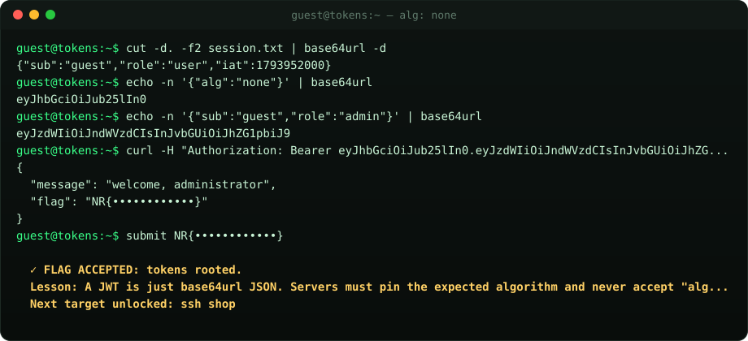

<div align="center">


# nullroute

### A hacking game that runs entirely in your browser.

Twelve machines. Twelve flags. One fake Linux terminal.<br>
Break in by doing what real attackers do, and learn **why** each attack works.

[](https://kirtanbhatt10.github.io/nullroute/)

[](https://github.com/kirtanbhatt10/nullroute/actions/workflows/ci.yml)




</div>

---

## The story

You are a contractor hired to red-team **Halcyon Dynamics**, a fictional company with very real security mistakes. Each machine hides a flag that looks like `NR{...}`. Capture it, `submit` it, and the next target unlocks.

No installs, no VMs, no Docker, no account. Open the page and type `ls`.

## The targets

| # | Host | You will learn | Tools you will reach for |
|---|---|---|---|
| 1 | `gate` | Hidden dotfiles | `ls -a`, `cat` |
| 2 | `needle` | Log forensics across 2,400 lines | `grep` |
| 3 | `courier` | Encoding is not encryption | `file`, `base64 -d`, pipes |
| 4 | `firmware` | Secrets inside binaries | `strings`, `rot13` |
| 5 | `gitleak` | Deleted secrets live forever in git history | `git log`, `git show` |
| 6 | `intranet` | Recon with robots.txt | `curl` |
| 7 | `tokens` | JWT forgery with `alg: none` | `cut`, `base64url`, `curl -H` |
| 8 | `shop` | SQL injection (login bypass) | `curl` with crafted input |
| 9 | `vault` | Cracking unsalted password hashes | `find`, `crack`, `su` |
| 10 | `billing` | IDOR: changing an ID to read another account | `curl` |
| 11 | `archive` | Path traversal with `../` | `curl` |
| 12 | `blackbox` | Breaking single-byte XOR with known plaintext | `xor -b`, `xor -k` |

Every flag comes with a short **lesson** explaining the real-world mistake and the fix. Stuck? `mentor` explains what to try next, and `hint` gives progressively stronger nudges, three or four per target.

## Mentor mode

New to the command line, or just stuck? Type `mentor`. It is a guide that lives inside the terminal and teaches you *how* to break in, without handing you the flag.

| Command | What it does |
| --- | --- |
| `mentor` | Where you are, what this target teaches, the tools worth trying, and your next move |
| `mentor next` | Just the next move, based on what you have already tried on this target |
| `mentor basics` | How to play: exploring, searching, pipes, submitting flags, moving between targets |
| `mentor <command>` | Learn a command with examples, e.g. `mentor grep`, `mentor curl`, `mentor pipes`, `mentor quotes` |
| `mentor on` / `off` | Live coaching while you play: catches typos (`lss` → did you mean `ls`?), explains errors, tells you when you have printed a flag but not submitted it, briefs you on each new target, and nudges you if you seem stuck |

The mentor reads what you have done so far, so its advice moves forward as you do. It never prints a flag. `hint` is still there when you want a more direct push. Your mentor on/off choice is saved, and survives `reset`.

## The terminal

It is a small, real shell, not a set of scripted answers:

- **35+ commands**: `ls cd cat head tail grep find wc sort uniq cut echo base64 base64url rot13 strings xxd file xor sha256sum crack curl git su ssh` and more
- **Pipes and quoting**: `strings door-ctl.bin | rot13 | grep key` and `echo -n '{"alg":"none"}' | base64url` work the way you expect
- **Simulated services**: HTTP servers with real routing, a JWT-checking API, a SQL login that actually parses your injection, a git repo with history, file permissions and users
- **Tab completion** for commands, paths and hosts; **arrow-key history**; `Ctrl+L` to clear
- **Saves your progress** in your browser; `levels` shows the mission map
- **Mobile friendly**, with a quick-key bar for `tab`, `|` and common commands
- **Installable and offline**: a service worker caches the whole game

Try a few easter eggs while you are in there. `sudo` is a good start.

## Run it yourself

```bash
git clone https://github.com/kirtanbhatt10/nullroute.git
cd nullroute
python3 -m http.server 8080      # open http://localhost:8080
```

There is no build step. It is plain HTML, CSS and JavaScript with zero dependencies.

## Tests

```bash
npm test
```

The suite includes a **full scripted playthrough** that solves all twelve targets the intended way, so a broken level fails CI. It also checks the SHA-256 implementation against `node:crypto`, base64/base64url against `Buffer`, the tokenizer, tampered-JWT rejection, SQL syntax errors, permissions, tab completion and progress persistence. CI runs on Node 18, 20 and 22.

## How it is built

```
shell.js    the engine: tokenizer, virtual filesystem, ~35 commands, HTTP/git/auth simulation
levels.js   the twelve targets: files, services, flags, hints and lessons
app.js      the terminal UI: rendering, history, completion, boot sequence
style.css   CRT-flavoured styling
sw.js       offline cache
```

Adding a level means adding one object to `levels.js`: a filesystem map, optional `http` handlers or `git` history, a flag, hints, a lesson and `mentor` guidance (concept, tools and steps). Then add its solution to `test/game.test.js`.

## Cheating

The flags are in `levels.js`. Reading the source is a perfectly legitimate hacking technique, and arguably the most important one. You will learn more by breaking in the intended way, though.

## Contributing

Ideas for new targets are very welcome: SSRF, cookie tampering, weak RNG, open redirects. Open an issue describing the vulnerability and the "aha" moment, or send a PR with the level and its test.

## License

[MIT](LICENSE) © 2026 Kirtan Bhatt. Halcyon Dynamics and everyone in it are fictional. Only attack systems you own or are authorized to test.
